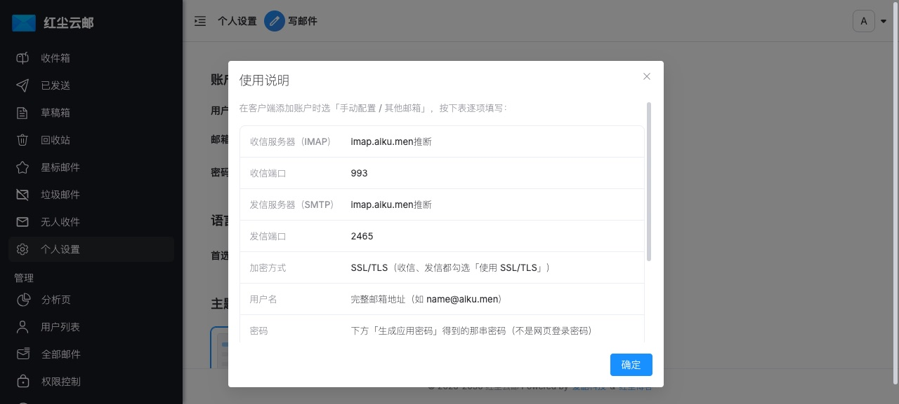
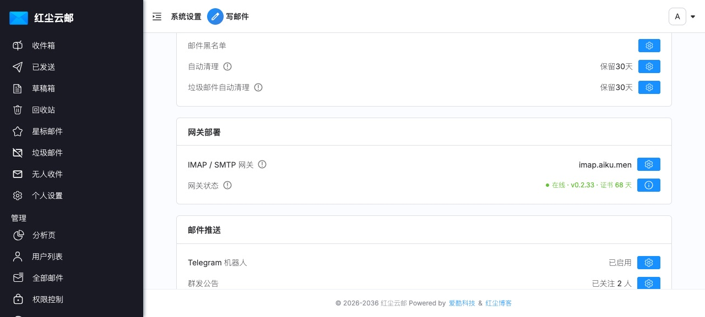
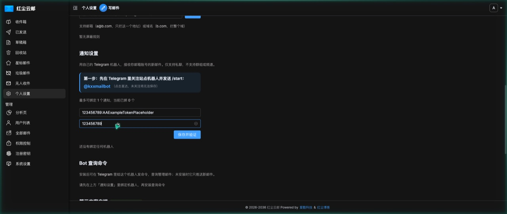
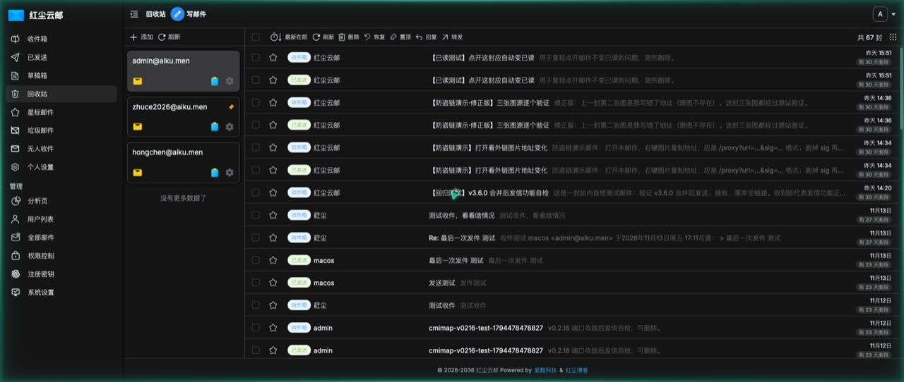
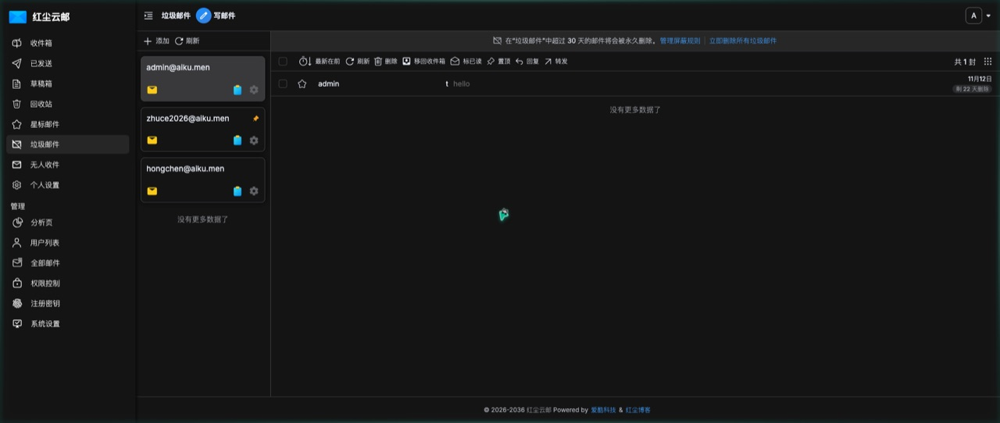

<p align="center">
    
    <h1 align="center">Cloud Mail · 红尘云邮（定制版）</h1>
    <p align="center"><strong>基于 Cloudflare Workers 的一站式邮箱服务</strong></p>
    <p align="center">
        <a href="https://www.cloudflare.com/" target="_blank">
            
        </a>
        <a href="https://github.com/kxx4988/cloud-mail-hongchen/releases" target="_blank">
            
        </a>
        <a href="LICENSE" target="_blank">
            
        </a>
    </p>
    <p align="center">
        <a href="README-en.md">English</a> | 简体中文 | <a href="README-ja.md">日本語</a>
    </p>
</p>

> **本仓库是 [maillab/cloud-mail](https://github.com/maillab/cloud-mail) 的定制分支（Fork），基于官方 v3.6.0，采用 MIT 协议。**
> 部署方式与官方一致；本文档只描述与官方版的差异。官方部署细节请参考 [官方文档](https://docs.skymail.ink)。
> 代码中的 `[Sxx]` / `[Bxx]` / `[Txx]` 是自研变更条目编号，对应下文「与官方版的差异」。

## 项目简介

只需要一个域名，就能创建多个邮箱账号，部署在 Cloudflare Workers 上，无需自备服务器。

本分支在官方版基础上补齐了一批日常使用中真正会碰到的功能：第三方客户端（IMAP/SMTP）接入、垃圾邮件规则、Telegram 用户级通知与机器人查询、邮件列表统一排序、回收站与无人收件视图、主题跟随系统等，并修复了官方版 22 个已知问题。

## ⚠️ 两件套配合使用（重要）

本项目的「第三方客户端」能力由**两个组件**共同提供，只部署主程序时该功能不可用：

| 组件 | 部署位置 | 负责什么 |
|---|---|---|
| **主程序**（本仓库） | Cloudflare Workers | 网页端收发、账号与数据、Telegram 通知、应用密码签发 |
| **IMAP 网关**（[kxx4988/cloud-mail-imap](https://github.com/kxx4988/cloud-mail-imap)） | 自己的 VPS（一条命令） | 为第三方客户端（Outlook / Thunderbird / 手机邮件 App）提供 IMAP 993 / SMTP 2465 |

- **不部署网关时**：个人设置 →「第三方客户端」里生成的应用密码没有服务器可连，配置客户端会连接失败。
- **推荐顺序**：先部署主程序 → 再按网关仓库的 README 部署网关 → 回到主程序「系统设置」保存网关域名 → 之后个人设置里的服务器地址与连接状态才会正确显示。

## 功能截图

| 第三方客户端（应用密码 + 使用说明） | IMAP 网关状态（系统设置） |
|---|---|
|  |  |

| Telegram 用户级通知（用自己的机器人收信） | 回收站（恢复 / 彻底删除 / 排序） |
|---|---|
|  |  |

| 垃圾邮件（屏蔽规则 / 30 天自动清理 / 来源标签） |
|---|
|  |

## 与官方版的差异

相对官方 v3.6.0：**95 个文件**（修改 68 / 新增 27），**+11,788 / −2,784 行**，82 条自研变更。

### 1. 第三方客户端（IMAP / SMTP）

- 账号级**应用密码**：可单独签发、可加备注与有效期、记录最近使用时间，与登录密码完全分离。
- 个人设置里的**使用说明**弹窗（收/发信服务器、端口、加密方式、用户名格式）；未配置网关时按邮箱域名推断并标注「推断」。
- **网关域名服务端化**：管理员在系统设置填一次，全站用户读取同一个值，不再依赖浏览器本地缓存。
- **网关心跳**：网关每小时上报版本与证书剩余天数，系统设置显示在线状态、版本号、证书天数；个人设置侧用「客户端最近成功登录时间」判断地址是否可信。

### 2. 垃圾邮件

- 独立的垃圾邮件视图，与收件箱分开。
- **屏蔽规则**：按发件邮箱或整个域名拦截，命中的邮件直接进垃圾邮件。
- 垃圾邮件**超过 30 天自动永久删除**，可在系统设置调整保留天数。
- 邮件来源标签（收件箱 / 已发送 / 转发等），便于判断邮件从哪来。

### 3. Telegram

- 内置 8 条机器人命令（收件箱、未读、按账号查看、详情、更多分页等），支持 `/more` 翻页。
- **用户级通知**：每个用户绑定自己的机器人，用自己的 token 与 Chat ID 接收自己账号的新邮件，账号之间互相隔离。
- 权限隔离：管理员与普通用户命令集不同；所有查询强制校验归属，查不到归属直接报错而不是返回空。
- 群发公告、垃圾邮件推送开关。

### 4. 邮件列表与工具栏

- 收件箱 / 已发送 / 回收站 / 垃圾邮件 / 全部邮件**五页统一排序按钮**（最新在前，改为大图标，抽成公共组件）。
- 主账号在侧栏恒置顶，别名账号可图钉置顶。
- 「无人收件」（没有归属账号的邮件）独立入口。
- 全站删除操作二次确认，提示条支持长文本换行。

### 5. 回收站与删除

- 回收站支持**恢复**与**彻底删除**（单个 / 批量）。
- 恢复接口与列表参数做兼容处理，避免无归属账号时的 501 问题。
- 切换账号时自动清空搜索条件，避免串账号。

### 6. 界面与主题

- 主题三档：浅色 / 深色 / **跟随系统**（自动响应系统外观变化）。
- 详情页「返回」按来源回跳（从垃圾邮件点进去就回垃圾邮件，不再固定回收件箱）。
- 写邮件按钮与顶栏三列网格布局优化，1366 及更窄屏可用。

### 7. AI 验证码提取

- 自动从邮件正文提取验证码，默认模型换为 `@cf/daily-co/phonellm-mini-alpha-2`（官方原默认模型已停用）。
- 实测该模型不会把订单号、发票号误判为验证码。

### 8. 官方 BUG 修复与主动取舍

- 修复官方 22 个问题（B01~B22）：Webhook 500、KV 缓存 404、时间显示时区、侧栏排序、账号切换残留、图片代理、转发规则匹配等。
- 主动移除或不做 7 项（T01~T07）：侧栏 compose-bar、星标按账号汇总、定时发送等。

> 逐条变更明细不在公开仓库维护（属于内部账），功能层面以上文为准。

## 快速部署

### 方式一：GitHub Actions（推荐，一键部署）

1. Fork 或克隆本仓库到你自己的 GitHub 账号。
2. 在 **Settings → Secrets and variables → Actions** 添加以下 Secrets：

| 名称 | 必需 | 说明 |
|---|---|---|
| `CLOUDFLARE_API_TOKEN` | ✅ | Cloudflare API Token，需 Workers Scripts / D1 / KV 编辑权限 |
| `CLOUDFLARE_ACCOUNT_ID` | ✅ | Cloudflare 账户 ID |
| `JWT_SECRET` | ✅ | 登录令牌密钥，任意随机字符串（不要含 `? % # / \`） |
| `DOMAIN` | ✅ | 邮箱域名，JSON 数组，如 `["example.com"]` |
| `ADMIN` | ✅ | 管理员邮箱，如 `admin@example.com` |
| `PASSWORD` | ⬜ | 管理员初始密码（仅首次初始化用） |
| `CUSTOM_DOMAIN` | ⬜ | 自定义域名，如 `mail.example.com` |
| `D1_DATABASE_ID` / `KV_NAMESPACE_ID` | ⬜ | 不填会自动创建 |
| `R2_BUCKET_NAME` | ⬜ | 需要 R2 存附件时填 |

3. push 到 `main`（改动 `mail-worker/` 或 `mail-vue/` 时触发），或在 Actions 页面手动运行工作流。
4. 工作流会依次：装依赖 → 构建前端 → 建/复用 KV 与 D1 → `wrangler deploy` → 调 `/api/init/<JWT_SECRET>` 初始化数据库。

> 未配置必需 Secrets 时，工作流会自动跳过部署并给出一条提示，**不会报错**。

### 方式二：本地 wrangler

```bash
# 1. 填配置：mail-worker/wrangler.toml 里取消注释并填入
#    [[d1_databases]] database_id、[[kv_namespaces]] id、domain、admin、jwt_secret
# 2. 安装与构建
cd mail-worker && pnpm install
cd ../mail-vue && pnpm install && pnpm run build
# 3. 部署
cd ../mail-worker && pnpm wrangler deploy
# 4. 初始化数据库（<JWT_SECRET> 换成你填的值）
curl https://你的域名/api/init/<JWT_SECRET>
```

返回 `success` 即初始化成功。首次登录用 `ADMIN` 邮箱 + `PASSWORD`。

### 部署后

- 系统设置 →「网关部署」保存 IMAP 网关域名（**不部署网关则第三方客户端不可用**）。
- 邮件投递需在 Cloudflare 配置 Email Routing 转发到 Worker。

## 目录结构

```
mail-worker/             Worker 后端（Cloudflare Workers + D1 + KV）
  src/api/               接口层
  src/service/           业务逻辑
  src/entity/            数据表定义
  wrangler.toml          部署配置（需自行填写资源 ID 与密钥）
mail-vue/                前端（Vue 3 + Element Plus + Vite）
  src/views/             页面
  src/i18n/              中英文案
  scripts/check-i18n.mjs i18n 构建门禁
doc/demo/                截图
```

## 如何跟进上游

本分支的原则是「尽量不动官方文件」：新功能优先新增文件；必须改官方文件时只做单点最小改动并加 `[Sxx]` 注释。官方发新版本时冲突面小、合并快。

如果你也在维护自己的分支，可以参考这个思路；如果只想用功能，直接按上面部署即可。

## 许可证

本项目基于 [maillab/cloud-mail](https://github.com/maillab/cloud-mail)，遵循 **MIT License**（见 [LICENSE](LICENSE)），保留原作者版权声明。

## 致谢

- [maillab/cloud-mail](https://github.com/maillab/cloud-mail) —— 上游项目与部署文档
- [Cloudflare Workers / D1 / KV](https://www.cloudflare.com/)
- [Vue 3](https://vuejs.org/) / [Element Plus](https://element-plus.org/)
